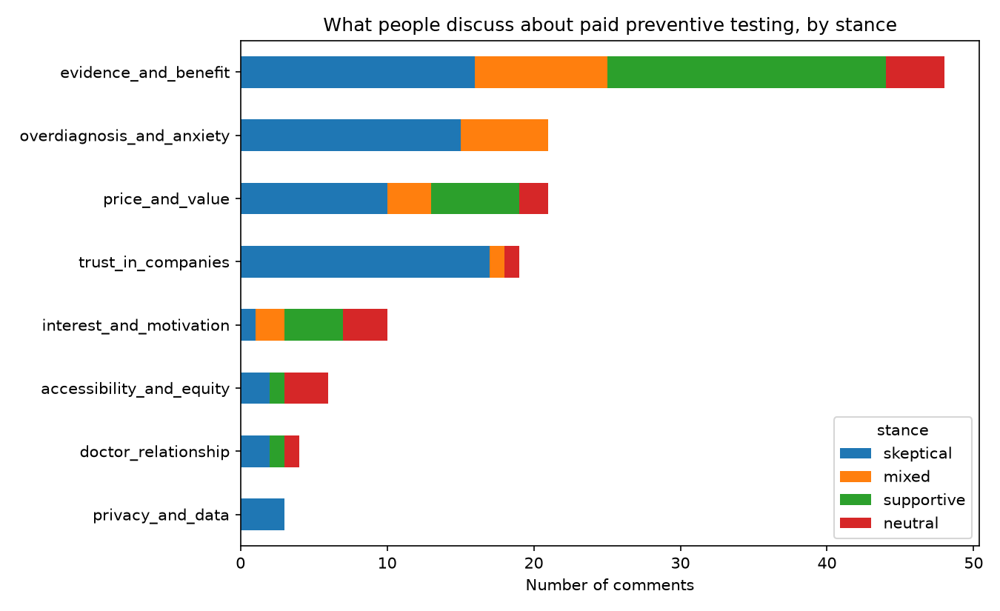

# Voice of the Market: attitudes toward paid preventive health testing

An automated research pipeline that collects public online discussions, uses a language model to classify them, and produces a structured, evidence-backed report on how people feel about paid preventive medicine (extensive blood panels, full-body scans, longevity clinics).

**Total cost: $0** (free API tier, open data sources, no paid services).

Final output: [`report.md`](report.md)

## The problem

Preventive medicine memberships sell to people who are healthy, so the main obstacle is not awareness but **skepticism**: Is it evidence-based? Is it worth the money? Can the companies be trusted? Before you can address those doubts in marketing or product design, you need to know what they actually are, how common they are, and who raises them.

Reading hundreds of forum comments by hand does not scale, and it is hard to stay consistent. This project turns unstructured discussion into a structured map of arguments, fears and objections.

## What I built

```
discover.py  ->  you review threads  ->  collect.py  ->  classify.py  ->  analyze.py  ->  report.py
 find HN          (human decision)        download all     LLM labels       counts, charts,   LLM writes short
 discussions                              comments +       relevance,       verified quotes   neutral summaries;
                                          manual data      stance, topics                     code inserts numbers
```

1. **Discover and curate.** `discover.py` searches Hacker News for discussions on preventive testing; I reviewed the candidates and kept the relevant ones (98 threads). Topic selection stays a human decision.
2. **Collect.** `collect.py` downloads all comments from those threads (author names are not stored) and merges them with comments I collected manually from Reddit.
3. **Classify.** `classify.py` sends comments in batches to a free LLM and gets strict JSON back: is the comment relevant, the stance (skeptical / supportive / mixed / neutral), topics from a fixed list, a one-sentence paraphrase and a short quote. The script is resumable, retries on rate limits and rotates between fallback models.
4. **Analyze.** `analyze.py` computes counts and charts, and **verifies that every quote really appears word-for-word in the source comment** (LLMs sometimes invent quotes; those are discarded).
5. **Report.** `report.py` builds the report. **Numbers, tables and quotes are inserted by code**; the model only writes short neutral summaries per topic. The report deliberately contains no recommendations: interpreting the findings is left to the specialist.
6. **Validate.** `validate.py` supports a manual accuracy check of the classifier.

## Key results

*296 comments classified, 73 judged relevant after cleaning.*

| Stance | Share of relevant comments |
|---|---|
| Skeptical | 45% |
| Supportive | 30% |
| Mixed | 12% |
| Neutral | 12% |

- **Evidence of benefit is the most contested topic** (48 of 73 relevant comments) and the only major one where supporters (19) are as vocal as skeptics (16).
- **Distrust of companies and fear of overdiagnosis are almost one-sided.** Trust in companies: 17 of 19 comments skeptical, none supportive. Overdiagnosis and false alarms: 15 skeptical, 6 mixed, none supportive.
- **Price and value** is split but leans skeptical (10 skeptical vs 6 supportive).
- Privacy, accessibility and the role of doctors appear in only 3-6 comments each, so I treat them as anecdotal.



## How reliable is this? (validation)

I manually checked 20 random comments that the model labeled "relevant":

- **16 of 20** were truly relevant to paid preventive testing (so roughly 1 in 5 "relevant" labels is wrong).
- Among those 16, the stance was correct in **13** and the topics in **15**.
- 88% of the quotes proposed by the model matched the source text verbatim; the rest were discarded.
- After reading the results I removed 7 clearly off-topic comments by hand (listed in `data/exclude_ids.txt`). The accuracy check was done before this cleaning.

Percentages should therefore be read as approximate, not precise.

## Limitations

- **Small sample:** 73 relevant comments; rare topics rest on a handful of comments.
- **Biased audience:** Hacker News skews technical and skeptical. Manual comments were selected by me.
- **Mixed time periods:** comments span 2015-2026, so different news cycles are pooled together.
- **Model errors:** see validation above. I did not measure recall (relevant comments the model missed).
- **Opinions, not behavior:** this shows what people say online, not what they buy.
- I did not benchmark time saved versus manual reading; I only know the model labeled 296 comments in roughly 30 API calls.

## What I would improve next

- Collect more data, especially Reddit via the official API, to reduce the Hacker News bias.
- Measure recall and run the classification with a second model to compare agreement.
- Split results by time period.
- Run the pipeline on a schedule (for example GitHub Actions) to track how attitudes change.

## Tech

Python (pandas, matplotlib, pydantic, requests), Hacker News public API, OpenRouter free-tier LLMs (NVIDIA Nemotron models), structured JSON output with schema validation, retries and model fallback.

I designed the research question and categories, chose the discussion threads, collected the manual comments, and validated the outputs. I used an AI assistant (Claude) to help write and debug the code.

## How to run

```
pip install -r requirements.txt

python discover.py            # find candidate HN threads -> data/threads.csv (edit it!)
python collect.py             # download comments -> data/posts.csv
                              # optional: data/manual.csv with columns text,url,thread

# set your key and model(s) (PowerShell shown)
$env:OPENROUTER_API_KEY="your_key"
$env:OPENROUTER_MODEL="model-id:free,fallback-model-id:free"
python classify.py --test     # try on 10 comments
python classify.py            # full run (resumable)

python analyze.py             # counts, chart, verified quotes
python validate.py make       # 20 random comments to check by hand
python validate.py score
python report.py --validation "..."
```

Raw comments are not included in this repository; run `discover.py` and `collect.py` to rebuild the dataset.
